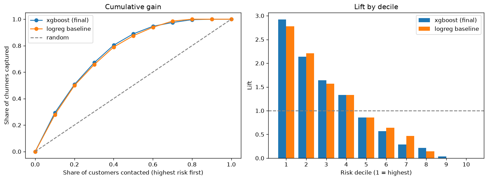
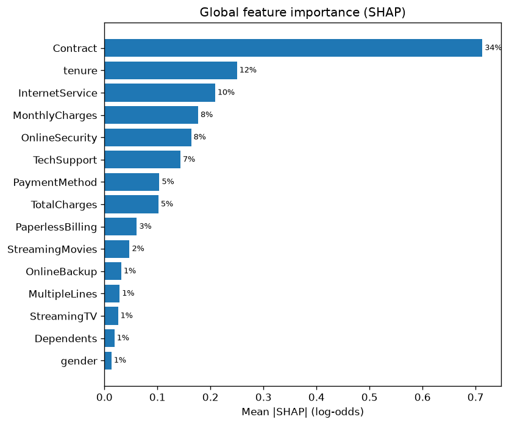
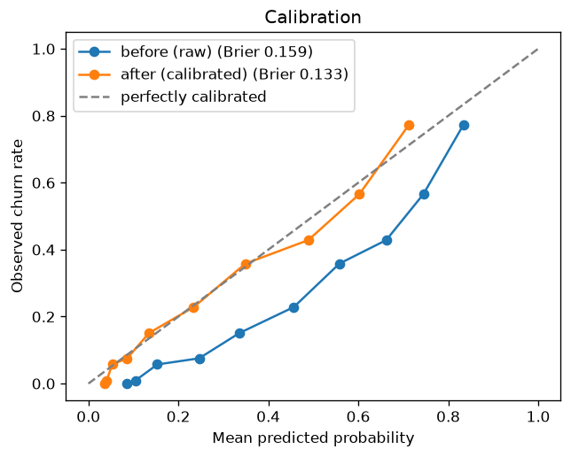

# Customer Churn Prediction

Predict which telecom customers will churn, explain **why** with SHAP, and turn predictions
into a ranked, costed retention plan.

**Headline:** contacting the 33% of customers the model flags reaches **73% of churners**.
Under placeholder costs, that earns **+12,400 per 1,000 customers**, while spending the same
budget at random **loses 3,400**.

## Problem
A subscription telecom business loses about 26.5% of its customers in a month. Retention
offers cost money, so they should go to customers who are both **likely to leave** and
**worth saving**, with a reason the retention team can act on.

- **Data:** [IBM Telco Customer Churn](https://github.com/IBM/telco-customer-churn-on-icp4d), 7,043 customers, 21 columns
- **Target:** `Churn = Yes` (left within the last month)
- **Primary metric:** PR-AUC, since churn is the minority class. Also ROC-AUC, recall and lift in the top 10% risk decile, and expected profit.

## Results (held-out test set, used once)

| Metric | **Final model (XGBoost)** | Logistic regression baseline |
|---|---|---|
| PR-AUC | **0.671** | 0.641 |
| ROC-AUC | **0.856** | 0.849 |
| Lift in top 10% | **2.92×** | 2.78× |
| Recall in top 10% | **29.3%** | 27.9% |

- The PR-AUC gain is +0.030, with a paired bootstrap 95% CI of **[+0.003, +0.055]**.
- **Calibrated:** predicted churn in each risk tier matches actual churn (High 58.3% vs 58.5%, Medium 31.7% vs 29.9%, Low 9.1% vs 7.7%). Calibration error fell from 0.153 to 0.027.

| Targeting strategy (1,057 test customers) | Profit |
|---|---|
| **Model targeting (349 contacts)** | **+13,150** |
| Random targeting (same 349 contacts) | −3,582 |
| Contact everyone | −10,850 |

**Top churn drivers (SHAP):** contract type (34%), tenure (12%), internet type (10%), monthly charges, and no security or tech-support add-ons.

<p>
  
</p>
<p>
  
  
</p>

Every customer in the ranked list gets a calibrated churn probability, a risk tier, their top 3 reasons and a primary and secondary action:

| rank | churn probability | tier | top reasons | primary action | secondary action |
|---|---|---|---|---|---|
| 1 | 0.78 | High | Contract = Month-to-month · tenure = 1 month · InternetService = Fiber optic | Discount to move to a 1- or 2-year contract | First-90-days onboarding program |

Full findings and recommendations: **[reports/final_report.md](reports/final_report.md)**

## Approach

| Phase | What | Status |
|---|---|---|
| 0 | Project setup, environment, tests | ✅ |
| 1 | Data understanding (EDA) | ✅ |
| 2 | Cleaning + leakage-safe stratified 70/15/15 split | ✅ |
| 3 | Feature engineering in a scikit-learn Pipeline | ✅ |
| 4 | Baseline → RF / XGBoost / LightGBM, tuning, cost-based threshold | ✅ |
| 5 | Evaluation + SHAP explainability | ✅ |
| 6 | Calibration, ranked risk list, retention recommendations | ✅ |
| 7 | Streamlit dashboard + monitoring plan (optional) | ⏳ |

**Keeping the evaluation honest:**
- All preprocessing is fit inside cross-validation folds on the training split only.
- The model and threshold are chosen on validation; the test set is scored exactly once.
- Leakage checks run on every split.

**Findings I didn't expect:**
- Untuned, the logistic regression baseline beat every tree model.
- Engineered features gave no accuracy gain, so the final model uses raw features.
- A column-order bug in `set_output` would have mislabelled SHAP explanations; it's fixed and covered by a regression test.

## How to run (Windows)

```bash
python -m venv .venv
.venv\Scripts\python -m pip install -r requirements.txt
.venv\Scripts\python -m src.data.download
.venv\Scripts\python -m src.pipeline
.venv\Scripts\python -m pytest
```

- The pipeline runs all 6 stages in about 6 minutes: clean → split → features → modeling → evaluation and SHAP → calibration and risk list.
- **Outputs:** metrics in `reports/metrics/`, figures in `reports/figures/`, and the customer list in `reports/output/customer_risk_list.csv` (gitignored).
- **Business assumptions** (offer cost, customer value, success rate) are placeholders in [`src/config.py`](src/config.py). Change them and rerun.
- With GNU Make installed: `make setup`, `make test`, `make lint`, `make pipeline`.

## Project structure
```
churn-project/
├── data/{raw,interim,processed}   # raw is read-only; data is never committed
├── notebooks/                     # 01_eda, 02_features, 03_model_analysis
├── src/
│   ├── config.py                  # paths, SEED=42, split sizes, business costs
│   ├── pipeline.py                # one-command entry point (6 stages)
│   ├── data/                      # download, load, clean, split (+ leakage checks)
│   ├── features/                  # build_features, preprocessing pipeline
│   ├── models/                    # baseline, train, tune, select, evaluate, analysis,
│   │                              # predict (calibration + risk list), recommend, business
│   ├── explain/                   # SHAP: global, per-customer, plain-language reasons
│   └── utils/                     # logging, seeding
├── models/                        # trained models (gitignored)
├── reports/
│   ├── figures/                   # EDA, features, evaluation, SHAP, calibration plots
│   ├── metrics/                   # CV, tuning, test, segment, SHAP, business tables
│   └── final_report.md            # findings and recommendations
└── tests/                         # pytest suite
```

## Tech stack
Python 3.14 · pandas · scikit-learn · XGBoost · LightGBM · SHAP · matplotlib/seaborn · pytest · ruff · black

## Resume bullets
- Built an end-to-end churn prediction pipeline (Python, scikit-learn, XGBoost) on 7,043 telecom customers. It reaches PR-AUC 0.671 and 2.9× lift in the top risk decile, beating a logistic regression baseline with a bootstrap-validated margin.
- Designed a cost-based targeting strategy with calibrated probabilities (calibration error 0.153 → 0.027). It reaches 73% of churners by contacting 33% of customers, earning about 12.4K per 1,000 customers vs a loss under random targeting.
- Explained predictions with SHAP, turning each customer's top 3 churn drivers into tiered retention actions. Identified contract type, early tenure and fiber service as the main levers.
- Kept evaluation leakage-safe: train-only preprocessing inside CV, validation-only model and threshold selection, a single test evaluation, and 60+ pytest tests, including a regression test for a feature-labelling bug.
