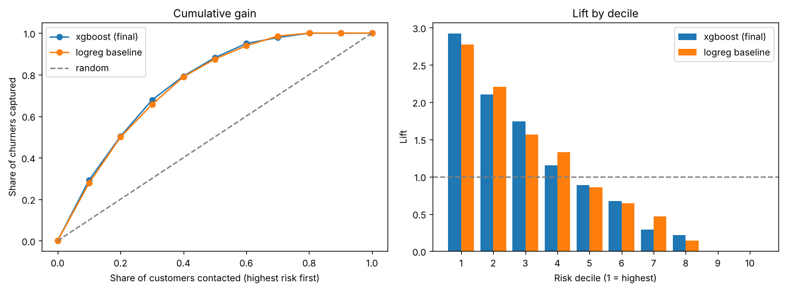
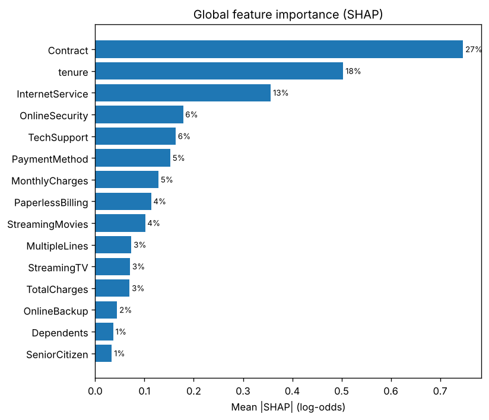
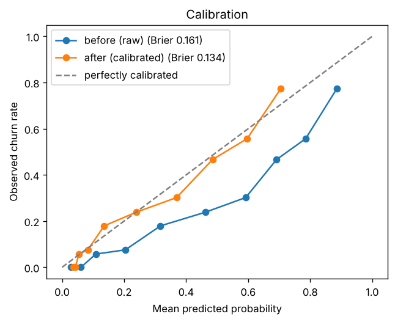
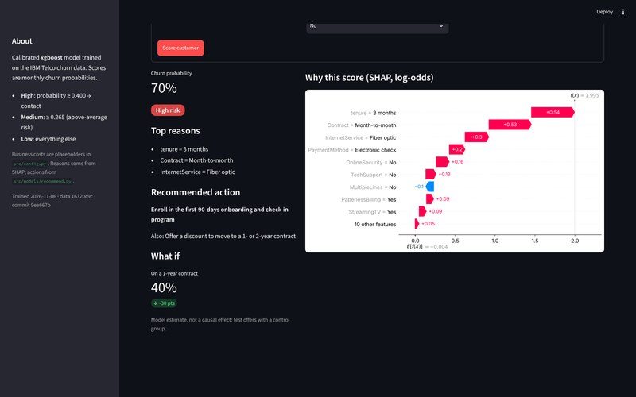
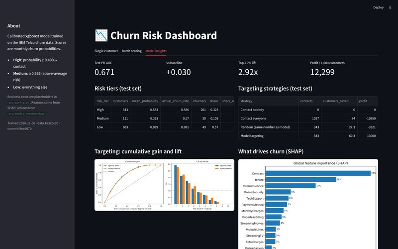

# Customer Churn Prediction

Predict which telecom customers will churn, explain **why** with SHAP, and turn predictions
into a ranked, costed retention plan.

**Headline:** contacting the 32% of customers the model flags reaches **72% of churners**.
Under placeholder costs, that earns **+12,300 per 1,000 customers**, while spending the same
budget at random **loses 3,300**.

> **Caveat: snapshot data.** In this dataset, `tenure` and `TotalCharges` for churned customers are
> measured when they left, while active customers are measured today. The model can partly learn
> "short tenure = already gone", which a live system scoring active customers cannot rely on, so
> the numbers below are likely optimistic. Details and a sensitivity check:
> [reports/final_report.md, section 6](reports/final_report.md).

## Problem
A subscription telecom business loses about 26.5% of its customers in a month. Retention
offers cost money, so they should go to customers who are both **likely to leave** and
**worth saving**, with a reason the retention team can act on.

- **Data:** [IBM Telco Customer Churn](https://github.com/IBM/telco-customer-churn-on-icp4d), 7,043 customers, 21 columns
- **Target:** `Churn = Yes` (left within the last month)
- **Primary metric:** PR-AUC, since churn is the minority class. Also ROC-AUC, recall and lift in the top 10% risk decile, and expected profit.

## Results (held-out test set, used once)

| Metric | **Final model (XGBoost)** | Logistic regression baseline |
|---|---|---|
| PR-AUC | **0.671** | 0.641 |
| ROC-AUC | **0.855** | 0.849 |
| Lift in top 10% | **2.92×** | 2.78× |
| Recall in top 10% | **29.3%** | 27.9% |

- The PR-AUC gain is +0.030, with a paired bootstrap 95% CI of **[+0.007, +0.052]**.
- **Robustness:** 5×5 repeated CV on train + validation gives a smaller gain of **+0.011** (95% CI [−0.006, +0.027]), so the edge over logistic regression is small and not statistically firm. Run `python -m src.models.repeated_cv`.
- **Calibrated:** predicted churn in each risk tier is close to actual churn (High 58.3% vs 58.6%, Medium 33.3% vs 27.0% on only 111 customers, Low 8.9% vs 8.1%). Calibration error fell from 0.149 to 0.033.

| Targeting strategy (1,057 test customers) | Profit |
|---|---|
| **Model targeting (343 contacts)** | **+13,000** |
| Random targeting (same 343 contacts) | −3,521 |
| Contact everyone | −10,850 |

**Top churn drivers (SHAP):** contract type (27%), tenure (18%), internet type (13%), then missing security and tech-support add-ons (6% each), payment method (5%) and monthly charges (5%).

<p>
  
</p>
<p>
  
  
</p>

Every customer in the ranked list gets a calibrated churn probability, a risk tier, their top 3 reasons and a primary and secondary action:

| rank | churn probability | tier | top reasons | primary action | secondary action |
|---|---|---|---|---|---|
| 1 | 0.78 | High | Contract = Month-to-month · tenure = 1 month · InternetService = Fiber optic | Discount to move to a 1- or 2-year contract | First-90-days onboarding program |

Full findings and recommendations: **[reports/final_report.md](reports/final_report.md)**

## Dashboard

A Streamlit app with three tabs:
- **Single customer:** a form gives the calibrated churn probability, risk tier, top 3 SHAP reasons, recommended actions, a SHAP waterfall and a "what if they sign a 1-year contract?" estimate.
- **Batch scoring:** upload a CSV (up to 10 MB, about 70,000 customers; or use the built-in sample) to get a ranked list with tier filters and a CSV download, plus a data-drift check (PSI) against the training data. Files with bad values are rejected with a message naming the column, the rows and the fix. The downloaded list is safe to open in Excel: text starting with `=`, `+`, `-` or `@` (a customer ID, say) gets a leading apostrophe so it cannot run as a formula.
- **Model insights:** headline metrics, risk tiers, targeting strategies and the key charts.

The dashboard also checks the model against its model card and warns when the raw data has changed since training, the model file was replaced after the card was written, or library versions differ. It shows when the model was trained in the sidebar, and notes models older than 90 days (`MODEL_MAX_AGE_DAYS` in `src/config.py`).

<p>
  
</p>
<p>
  
</p>

How the model would be watched in production (drift alerts, calibration checks, campaign uplift, retraining triggers): **[reports/monitoring_plan.md](reports/monitoring_plan.md)**

## Approach

| Phase | What | Status |
|---|---|---|
| 0 | Project setup, environment, tests | ✅ |
| 1 | Data understanding (EDA) | ✅ |
| 2 | Cleaning + leakage-safe stratified 70/15/15 split | ✅ |
| 3 | Feature engineering in a scikit-learn Pipeline | ✅ |
| 4 | Baseline → RF / XGBoost / LightGBM, tuning, cost-based threshold | ✅ |
| 5 | Evaluation + SHAP explainability | ✅ |
| 6 | Calibration, ranked risk list, retention recommendations | ✅ |
| 7 | Streamlit dashboard + monitoring plan | ✅ |

**Keeping the evaluation honest:**
- All preprocessing is fit inside cross-validation folds on the training split only.
- The model and threshold are chosen on validation; the test set is scored exactly once.
- Leakage checks run on every split.

**Findings I didn't expect:**
- Untuned, the logistic regression baseline beat every tree model.
- Engineered features gave no accuracy gain, so the final model uses raw features.
- An interpretable Explainable Boosting Machine matches XGBoost in repeated CV (PR-AUC 0.668 vs 0.667), with exact per-feature explanations. See section 2 of the report; `python -m src.models.ebm`.
- A column-order bug in `set_output` would have mislabelled SHAP explanations; it's fixed and covered by a regression test.

## How to run

Needs Python 3.14 (the versions in `requirements.txt` are pinned on it). Create a virtual environment and activate it:

```bash
python -m venv .venv
source .venv/bin/activate      # Linux / macOS
.venv\Scripts\activate         # Windows (cmd or PowerShell)
```

Then the same commands work on every platform:

```bash
python -m pip install -r requirements.txt
python -m src.data.download
python -m src.pipeline
python -m pytest
python -m streamlit run app/app.py
```

Without activating, call the venv's interpreter directly: `.venv/bin/python` (Linux / macOS) or `.venv\Scripts\python` (Windows).

- `pytest` includes an end-to-end smoke test (about a minute) that runs the whole pipeline on synthetic data in a temp directory; skip it with `pytest -m "not slow"`. The `CHURN_ROOT` environment variable redirects every data, model and report path.
- The pipeline runs all 7 stages in about 2 minutes on a 4-core machine: clean → split → features → modeling → evaluation and SHAP → calibration and risk list → model card.
- **Model card:** the last stage writes `models/model_card.json` (next to the model) and `reports/model_card.md`: data hash, split sizes, hyperparameters, threshold, metrics, library versions, git commit and known limitations. Rerun it alone with `python -m src.models.model_card`. Both files are gitignored because they record the local environment.
- **Outputs:** metrics in `reports/metrics/`, figures in `reports/figures/`, and the customer list in `reports/output/customer_risk_list.csv` (gitignored).
- **Business assumptions** (offer cost, customer value, success rate) are placeholders in [`src/config.py`](src/config.py). Change them and rerun.
- The dashboard opens at http://localhost:8501. It needs the pipeline outputs in `models/`, and `.streamlit/config.toml` keeps it local-only.
- With GNU Make installed: `make setup`, `make test`, `make lint`, `make pipeline`, `make app`.

## Development checks

- **Pre-commit hook:** `python -m pip install pre-commit`, then `pre-commit install` once. From then on every commit runs `ruff` and `black --check` on the staged files in `app/`, `src/` and `tests/`, the same checks CI runs. Run it on everything with `pre-commit run --all-files`. The tool versions in `.pre-commit-config.yaml` must match `requirements.txt`.
- **Dependency updates:** Dependabot opens a weekly PR for the pinned Python packages (minor and patch bumps grouped into one) and for the GitHub Actions in CI. CI runs on each one, so a bad update shows up as a red check.
- **Real-data check:** CI runs the pipeline only on synthetic data. A weekly job (`.github/workflows/real-data.yml`, also runnable by hand from the Actions tab) downloads the checksum-verified dataset, runs the full pipeline and checks the outputs with `python -m src.models.health`: the model beats the baseline, test PR-AUC is within 0.03 of 0.671, calibration is sound, the data hash matches and the risk list is complete. Run the same check locally after `python -m src.pipeline`. If the weekly run fails, the job opens a GitHub issue (or comments on the open one) so you are notified as a watcher of the repository; the next passing run closes it. To test the alert, run the workflow by hand with "Fail on purpose" ticked.
- **Coverage and Python versions:** CI runs the tests with a coverage floor (`--cov-fail-under=74`, currently about 76%) so new code cannot land untested; raise the floor as tests grow. A second job, `python-3-13`, runs the suite on Python 3.13 (requirements are pinned on 3.14, `pyproject.toml` allows 3.11+). The dashboard itself is smoke-tested in `tests/test_dashboard.py` with Streamlit's `AppTest` and a toy model, so no data or trained model is needed.
- **Docker (optional):** `docker build -t churn-dashboard .` then `docker run --rm -p 127.0.0.1:8501:8501 -v churn-artifacts:/app/models -v churn-data:/app/data churn-dashboard`. The first start downloads the data and trains the model (about 2 minutes); the volumes keep them for later runs.
- **Merging:** `main` should require the `lint-and-test` check to pass before a PR can merge (a repository setting, not a file).

## Project structure
```
churn-project/
├── data/{raw,interim,processed}   # raw is read-only; data is never committed
├── notebooks/                     # 01_eda, 02_features, 03_model_analysis
├── src/
│   ├── config.py                  # paths, SEED=42, split sizes, business costs
│   ├── pipeline.py                # one-command entry point (7 stages)
│   ├── data/                      # download, load, clean, split (+ leakage checks)
│   ├── features/                  # build_features, preprocessing pipeline
│   ├── models/                    # baseline, train, tune, select, evaluate, analysis,
│   │                              # predict (calibration + risk list), recommend, business,
│   │                              # monitor (PSI drift), model_card, ebm
│   ├── explain/                   # SHAP: global, per-customer, plain-language reasons
│   └── utils/                     # logging, seeding
├── app/                           # Streamlit dashboard (app.py) + tested helpers
├── models/                        # trained models (gitignored)
├── reports/
│   ├── figures/                   # EDA, features, evaluation, SHAP, calibration plots
│   ├── metrics/                   # CV, tuning, test, segment, SHAP, business tables
│   ├── final_report.md            # findings and recommendations
│   └── monitoring_plan.md         # production monitoring and retraining triggers
├── tests/                         # pytest suite (incl. dashboard smoke tests)
├── Dockerfile                     # optional container for the dashboard
└── LICENSE                        # MIT
```

## Tech stack
Python 3.14 · pandas · scikit-learn · XGBoost · LightGBM · SHAP · Streamlit · matplotlib/seaborn · pytest · ruff · black

## Resume bullets
- Built an end-to-end churn prediction pipeline (Python, scikit-learn, XGBoost) on 7,043 telecom customers. It reaches PR-AUC 0.671 and 2.9× lift in the top risk decile on a held-out test set, ahead of a logistic regression baseline (+0.03 PR-AUC). Repeated cross-validation puts that gain nearer +0.01, within noise, so the main value comes from targeting, not the algorithm.
- Designed a cost-based targeting strategy with calibrated probabilities (calibration error 0.149 → 0.033). It reaches 72% of churners by contacting 32% of customers, earning about 12.3K per 1,000 customers vs a loss under random targeting.
- Explained predictions with SHAP, turning each customer's top 3 churn drivers into tiered retention actions. Identified contract type, early tenure and fiber service as the main levers.
- Shipped a Streamlit dashboard for single and batch scoring with SHAP explanations and PSI drift checks, plus a production monitoring plan with alert thresholds and retraining triggers.
- Kept evaluation leakage-safe: train-only preprocessing inside CV, validation-only model and threshold selection, a single test evaluation, and 80+ pytest tests, including a regression test for a feature-labelling bug.
